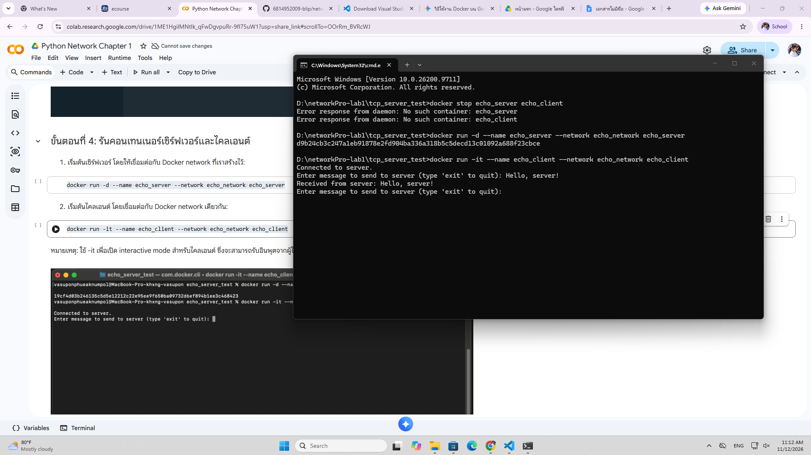
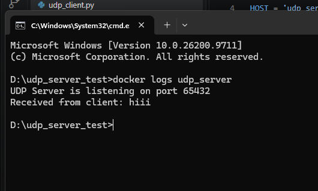

# รายงานผลการทดลอง: Network Programming Lab 1

### ข้อมูลผู้จัดทำ
- **ชื่อ-นามสกุล:** (ใส่ชื่อ-นามสกุลของคุณที่นี่)
- **รหัสนักศึกษา:** (ใส่รหัสประจำตัวนักศึกษาที่นี่)

---

### 🖥️ ผลการทดสอบการส่งข้อความ

#### รูปที่ 1: ภาพหน้าจอ Terminal ตอนทดสอบส่งข้อความระหว่าง Client-Server ของ TCP Echo

    

#### รูปที่ 2: ภาพหน้าจอ Terminal ตอนทดสอบส่งข้อความระหว่าง Client-Server ของ UDP Echo

    

